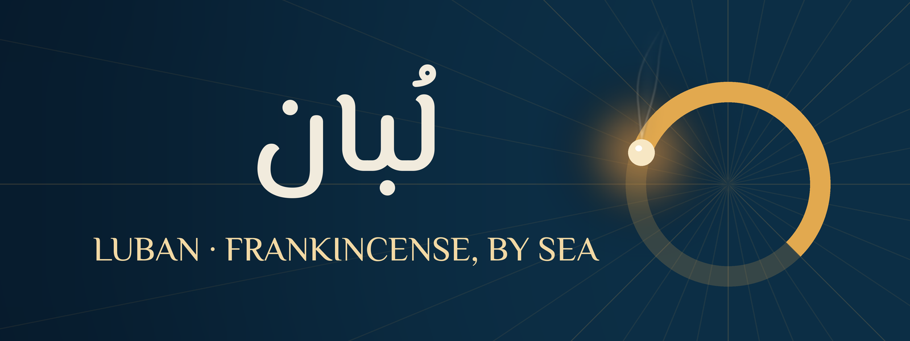
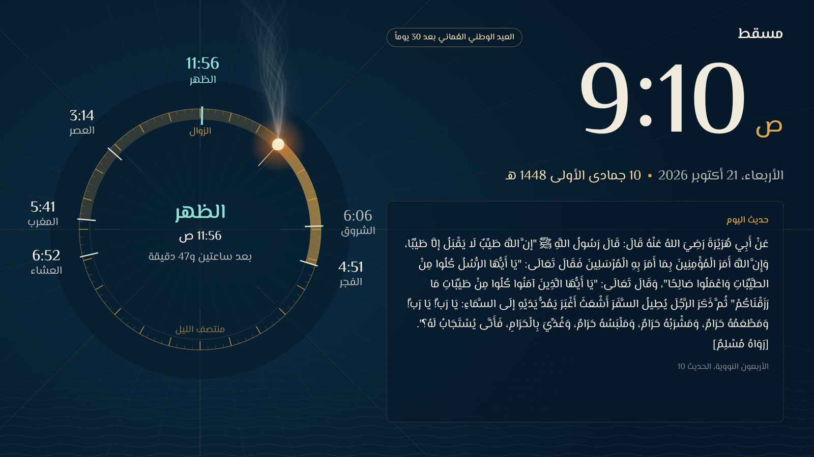
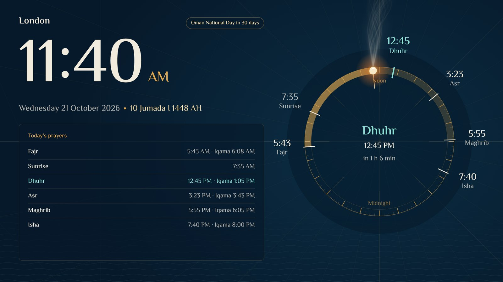

<p align="center"></p>
<p align="center"></p>
<p align="center"></p>

<div dir="rtl">

# لُبان

**شاشة توقف وواجهة رئيسية لتلفزيونات Android TV و Google TV، بهويّة عُمانية، لكل بيت في العالم.**

اليوم كله على بوصلة الملّاحين العُمانيين: الزوال في الأعلى ومنتصف الليل في الأسفل، والصلوات مواقع على حافتها،
و«الآن» حبّة لُبان متّقدة يتصاعد دخانها فوق خريطة بحرية؛ فاللبان هو ما حمله العُمانيون عبر هذا البحر إلى العالم.
ومعها الساعة والتاريخ الهجري ومواقيت الصلاة والإقامة (مطابقة لتقويم وزارة الأوقاف)، والطقس والغبار، ومباريات
فرقك، والذهب بالريال العُماني، وآية أو حديث اليوم. ويمكن اختيار صور من عُمان خلفيةً بدل الخريطة.
يوجد عدّ تنازلي للعيد الوطني (20 و21 نوفمبر)، وتنبيه لموسم الخريف في ظفار. وتُضبط الإعدادات كلها من الجوال
بمسح رمز QR، دون حاجة إلى الريموت.

## ماذا تحصل؟

| | |
|---|---|
| **شاشة لُبان** (شاشة التوقف) | بوصلة اليوم وجمرة اللبان، وساعة كبيرة، والتاريخان الميلادي والهجري، والصلوات الست مع العدّ للصلاة القادمة ثم للإقامة، و«الجمعة» مكان الظهر يوم الجمعة. وبطاقة بجانب الساعة تختارها: آية أو حديث، مواقيت اليوم، طقس الأيام القادمة، مباريات فرقك، أو جديد المسلسلات |
| **لُبان الرئيسية** (الواجهة) | واجهة عربية خفيفة فيها صفّ المفضلة، وكل التطبيقات، والمداخل (HDMI)، وحالة الشبكة، وبطاقة «الصلاة القادمة» إن أردتها |
| **إعدادات من الجوال** | افتح التطبيق على التلفزيون، وامسح الرمز، واختر المدينة وطريقة الحساب والفرق وكل شيء |
| **خادم بيانات** (اختياري) | خدمة صغيرة على Coolify تجمع المباريات والأسواق مرة واحدة لكل التلفزيونات |

**مدن عُمان الإحدى عشرة كلها** (37 ولاية) في رأس القائمة، ثم مدن من الخليج والعالم، لكل منها منطقتها
الزمنية وطريقة الحساب المعتمدة فيها. ويمكن إضافة أي مكان آخر بإحداثياته.

## على أي تلفزيون يعمل؟

على أي تلفزيون أو جهاز يعمل بنظام **Android TV أو Google TV (إصدار 8 فأحدث)**، أياً كانت الشركة المصنّعة: سوني وTCL
وفيليبس وشاومي، وأجهزة Hisense العاملة بنظام Google TV، وNvidia Shield وChromecast. **لا يعمل** على سامسونج (Tizen)
ولا إل جي (webOS) ولا Hisense VIDAA ولا Roku. وAmazon Fire TV لا يسمح بتغيير شاشة التوقف ولا الواجهة.
التفاصيل في [docs/COMPATIBILITY.md](docs/COMPATIBILITY.md).

## التركيب

### ① على التلفزيون
الإعدادات ← النظام ← حول ← اضغط OK على **Build** سبع مرات. ارجع إلى **خيارات المطوّر** وشغّل
**تصحيح USB** (وكذلك **التصحيح عبر الشبكة** إن وُجد).

### ② على كمبيوتر متصل بشبكة الواي فاي نفسها

```bash
git clone https://github.com/AQBassam/Luban && cd Luban
pip install adb-shell cryptography
python3 tools/luban.py setup
```

سيطلب منك التلفزيون الموافقة مرة واحدة («Allow USB debugging?»)، ثم يكمل التركيب وحده. في النهاية تظهر
على التلفزيون شاشة فيها رمز QR: امسحه بجوالك واختر مدينتك. ويعرض عليك الأداة إطفاء تصحيح ADB
بعد الانتهاء: وافق، فهذا أكثر أماناً.

<sub>هل تفضّل مساعداً ذكياً؟ الصق في Claude Code أو Codex: «ركّب تلفزيوني من https://github.com/AQBassam/Luban باتباع docs/AGENT.md خطوة بخطوة».</sub>

### إرجاعه كما كان
`python3 tools/luban.py reset`: يحذف تطبيقاتنا، ويعيد تشغيل كل ما أطفأناه، ويُرجع الواجهة الأصلية.

## لماذا هو آمن؟

- **تحديثات الشاشة موقّعة:** لا يقبل التلفزيون أي تحديث إلا إذا كان موقّعاً بمفتاح لُبان، وأحدث مما يعمل
  عليه. تصل التحديثات أولاً إلى عُشر الأجهزة، ثم إلى البقية بعد يومين.
- **صفحة الشاشة بلا صلاحيات:** لا تصل إلى ملفات التلفزيون، ولا إلى أي جهاز في الشبكة المنزلية.
- **الإعدادات من الجوال تحتاج الرمز:** لا يستطيع أي جهاز آخر على الواي فاي تغيير شيء ما لم يرَ الشاشة.
- **التطبيقات موقّعة ومثبّتة البصمة:** ترفض أداة التركيب أي APK بتوقيع مختلف، ولا تحذف تطبيقاً لتتجاوز هذا الرفض.
- **تبديل الواجهة لا يترك التلفزيون بلا واجهة:** لا تُطفأ الواجهة الأصلية إلا بعد التأكد من أن واجهة لُبان تعمل.

التفاصيل في [docs/SECURITY.md](docs/SECURITY.md).

</div>

---

# Luban

**A screensaver and home screen for Android TV / Google TV, Omani by design, for homes everywhere.**

The whole day on an Omani navigator's star compass: noon at the top, midnight at the bottom, the prayers as bearings
on the rim, and "now" a lit grain of frankincense whose smoke rises across a sea chart, because frankincense is what
Oman carried across this sea to the world. With it: the clock, Hijri date, prayer times and iqama computed on the TV
(matching Oman's Ministry of Awqaf calendar), weather and dust, your teams' matches, gold in Omani rials, a verse or
hadith of the day. Photographs of Oman can replace the chart as the background. A countdown to Oman's National Day (20–21 November) and the Khareef season in Dhofar. Every setting from
your phone by scanning a QR code; the remote is never needed for typing.

Luban (لُبان) is frankincense, which Oman has traded with the world for thousands of years.

## What you get

| | |
|---|---|
| **Luban screen** (screensaver) | The day's compass and the frankincense ember, a large clock, Gregorian and Hijri dates, six prayer times with a countdown to the next and then to the iqama, Jumu'ah on Fridays. A card beside the clock: verse or hadith, today's prayers, the forecast, your teams, or new episodes |
| **Luban home** (launcher) | A light Arabic home screen: favourites, all apps, HDMI inputs, network state, an optional "next prayer" card |
| **Phone settings** | Open the app on the TV, scan the code, set the city, method, teams, everything |
| **Data server** (optional) | A small service for Coolify that fetches matches and markets once for every TV ([server/](server/README.md)) |

**Places:** all 11 governorates of Oman (37 wilayats) first, then cities across the Gulf and the world, each with its
own time zone and its local calculation method, or any place by coordinates. **14 calculation methods**, Hanafi
Asr, per-prayer minute adjustments, per-prayer iqama, Hijri date adjustment ([docs/PRAYER-METHODS.md](docs/PRAYER-METHODS.md)).
**Arabic and English**, Western (0–9) or Arabic-Indic (٠–٩) digits.

## Which TVs

Any TV or box with **Android TV / Google TV 8.0+**, whatever the maker. Not Samsung (Tizen), LG (webOS), Hisense VIDAA
or Roku; Fire TV does not allow a third-party screensaver or home. See [docs/COMPATIBILITY.md](docs/COMPATIBILITY.md).

## Install

1. **On the TV:** Settings → System → About → press OK on **Build** seven times → Developer options → turn on
   **USB debugging** (and **Network debugging** if listed).
2. **On a computer on the same Wi-Fi:**
   ```bash
   git clone https://github.com/AQBassam/Luban && cd Luban
   pip install adb-shell cryptography
   python3 tools/luban.py setup
   ```
   Accept «Allow USB debugging?» on the TV once. At the end the TV shows a QR code: scan it to pick your city.
   The tool then offers to turn ADB off again; say yes.
3. **Or let an AI agent do it:** in Claude Code or Codex, paste *"Set up my TV with https://github.com/AQBassam/Luban
   following docs/AGENT.md step by step."*

**Undo everything:** `python3 tools/luban.py reset`. Other commands: `find`, `status`, `settings`, `favourites`,
`update`, `home`, `debloat`, `adb-off` (`--help` on each).

**APKs:** [releases](https://github.com/AQBassam/Luban/releases), every build numbered `v1.N`, each with `SHA256SUMS`.
Signing certificate SHA-256: see [keys/apk-cert.sha256](keys/apk-cert.sha256).

## Safe by design

Signed over-the-air screen updates with rollback protection and a canary channel · a page with no file access, no
bridge into the app and an allowlisted proxy · phone settings behind a per-session token · pinned APK signer, no
silent uninstall · Home switched only after the new one is proven · ADB turned off afterwards · CI with
commit-pinned actions, tests gating every release. Details: [docs/SECURITY.md](docs/SECURITY.md).

## For developers

```
web/            the screen (HTML/CSS/JS, no framework) and the phone settings page; python3 web/build.py → dist/
content/        cities, verses, hadith, photos, Arabic team names (verses and hadith generated by tools/content.py)
android/app     om.luban.screen: DreamService, preview, settings + QR, phone server, signed updates
android/launcher om.luban.home: the home screen; PrayerTimes.java is the twin of web/js/prayer.js
server/         the optional data server (Python stdlib, Dockerfile for Coolify)
tools/          luban.py (setup over ADB), sign.py, photos.py, content.py, brand.py
tests/          run.sh runs everything: static rules, server, setup tool, signatures, Java = JS, the page in Chromium
```

`dist/luban.html` runs in any browser (F11 for full screen); settings go in the URL: `luban.html#s=<base64 JSON>`.

A push to `main` runs the tests, builds and lints both APKs, and (with the signing secrets set) publishes
`v1.N`, `apk-latest`, and a signed screen bundle to `screen-canary`; `promote.yml` moves it to `screen-stable`
after 48 hours. Repository secrets: `LUBAN_KEYSTORE_B64`, `LUBAN_KEYSTORE_PASSWORD`, `LUBAN_UPDATE_KEY`.

## Credits

Fonts: [El Messiri](https://github.com/Gue3bara/El-Messiri) and [Amiri](https://www.amirifont.org/) (SIL OFL).
Photos: Wikimedia Commons photographers (Quality images of Oman), each with its licence in [docs/PHOTO-CREDITS.md](docs/PHOTO-CREDITS.md). Quran text: King Fahd Complex Uthmani
Hafs edition and the Forty Hadith of an-Nawawi, via [fawazahmed0](https://github.com/fawazahmed0)'s public-domain
datasets. Weather: [Open-Meteo](https://open-meteo.com). Matches: [TheSportsDB](https://www.thesportsdb.com).
Shows: [TVMaze](https://www.tvmaze.com). Package ratings: [UAD-ng](https://github.com/Universal-Debloater-Alliance/universal-android-debloater-next-generation).

MIT licence. Made in Oman · صُنع في عُمان
